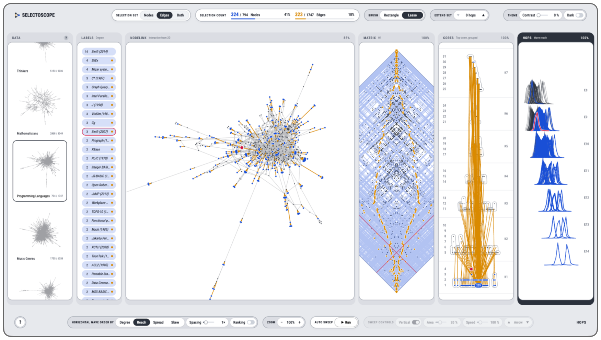

# SELECTOSCOPE
Selectoscope is a visual tool that lets you explore network structure through linked interpretable views. Select nodes and/or edges from the visual pattern in one pane to examine the same selection set in other panes.

<a></a>

## Quick start
The interface has three parts. The top control strip has selection set choice (node sets, edge sets, or both), a report of selection counts, choice of brush modality, and controls that grow or shrink sets. Then the primary view, or the main middle view, is composed of panes that show the same network dataset in various ways, surfacing different yet interpretable visual patterns. Finally, the bottom control strip is dynamic, changing offered controls in response to the focused pane.

Consider these steps as a quick start:

1. Change the loaded data from the DATA pane, which can be toggled back from this HELP pane by clicking the ? button.
2. Drag in any pane to brush a selection area around a visual pattern that catches your eye.
3. Then look across to other panes, the same nodes light up blue and edges orange, wherever they sit.
4. Click ▲ in EXTEND SET to grow your selection by one hop, and see how far the selection spreads.
5. Run AUTO SWEEP at the bottom control strip to scan an animated selection band area across the vertical span of the pane, then watch the selection across every other pane.
6. Hover the SELECTION COUNT in the top control strip and click CLEAR to start over, or lasso an empty region in any pane.

## Panes
Each pane draws the same loaded network in its own way.

**Labels.** One row per node, where rows selected are automatically sorted to the top for visibility, once the pointer leaves the list.

**NodeLink.** All datasets can be shown with a standard force-directed 2D, seeded by the first two harmonics of the spectral eigendecomposition (see MATRIX PANE description below). Similarly, a force-directed 3D, seeded by the first three harmonics, is computed last for datasets that don't bring their own 3D layout; for those that do, click COMPUTE 3D LAYOUT in the 3D layout. Datasets can bring their own layouts: BESPOKE 2D shows the dataset's own 2D layout, and BESPOKE 3D shows the dataset's own 3D layout.

**Matrix.** The visual idiom is the classic Adjacency Matrix, where edges are points, and their respective nodes drawn as lines along rows and columns. By default the matrix is shown as a DIAMOND with the diagonal running vertically, though the traditional SQUARE view is also available.

**Cores.** A new visual idiom we call kSnakes, where nodes are points that are vertically placed according to k-core shell membership (reported as text on the right side of the pane), which maps height to the depth into the graph's dense core. Nodes in the densest core are at the top, while nodes in the sparse periphery are at the bottom. Within each k-core shell, the onion decomposition (numbers on the left) sets every node's height, which creates snake-like visual patterns. Node points are drawn within an enclosure if they are part of the same connected component within that k-core shell.

**Hops.** A new visual idiom we call HopCensus, where nodes are polyline drawn from a vector of integers in a shared coordinate system: stubs (edge ends) met for the first time at each hop from the node, starting from its degree at hop 0, until the whole graph is traversed. The shape of the polyline comes from the varying stub counts, while the traversal extent in hops maps to the length of polyline, or the node's eccentricity (reported as text on the right side of the pane). Locally, polylines are drawn within a unit square, all share the same vertical scale; the tallest and longest set the relative extremes within the unit square. In the overall vertical span of the pane, the most central nodes are at the top (shortest polyline lengths, the radius nodes), while the nodes on the graph's perimeter are at the bottom (longest polyline lengths, the diameter endpoint nodes).

## Using your own data
Click the +NEW row in the DATA pane to add your own network data. Choose BUILD FROM CSV to create a dataset from an edgelist, or UPLOAD FROM JSON to open a previously built and exported SELECTOSCOPE dataset. All processing happens in your browser, and your files never leave it. Selectoscope supports up to 10,000 nodes and 100,000 edges.

To build a dataset, the main file format is the EDGELIST, a CSV file with 'source' and 'target' columns, one edge per row. Selectoscope automatically cleans the edgelist information: edge direction is ignored, self-loops are removed, duplicate edges are merged, and only the largest connected component is kept. Click ADD to build.

Per dataset built through CSV, optional files must use the 'node_id' column and match the EDGELIST. There are three optional CSV files to upload. The BESPOKE 2D layout requires 'node_id', 'x', and 'y' columns, and BESPOKE 3D requires 'node_id', 'x', 'y', and 'z' columns, both of which must account for every node in EDGELIST. The LABELS requires 'node_id' and 'label' columns, and in contrast to the bespoke layouts, labels can be partial.

Once built, the options in CHANGE can add, replace, or remove files.

Click EXPORT JSON to save a built dataset. Reopen the dataset using + NEW and UPLOAD FROM JSON, without rebuilding.

The curated datasets are already built and ready to use.

## Run it
Needs Node 24.

```
npm ci
npm run dev
npm test
```

Curated dataset sources and their licences are in [docs/data_sources.md](docs/data_sources.md). The MIT licence covers the code; each dataset stays under its source's terms.
